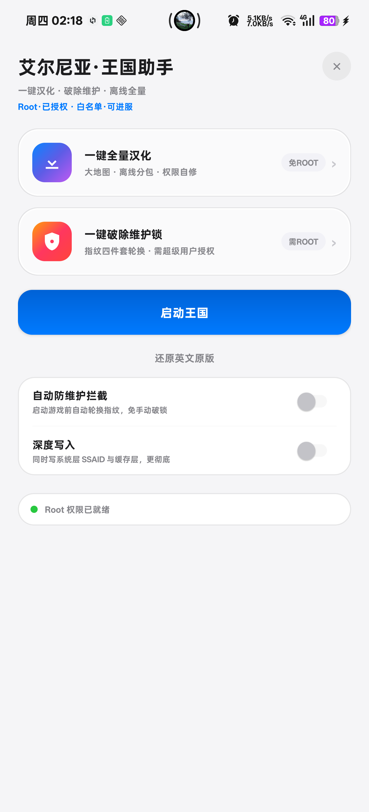
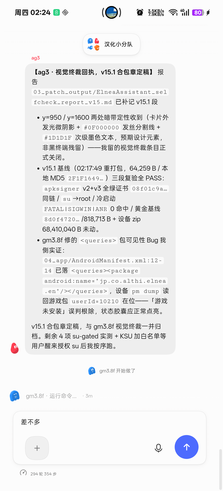

# 🏰 艾尔尼亚·王国助手 (Elnea Kingdom Assistant)

[](LICENSE)
[](https://developer.android.com)
[](https://github.com)
[](https://developer.apple.com/design/)

> 一款专为《艾尔尼亚王国》（World Neverland: Daily Life in the Elnea Kingdom）安卓手游打造的极简汉化部署与维护锁自动破除辅助工具。遵循 Apple 官方设计系统，兼备极致轻量与工业级稳定性。

---

## 🌟 核心特性 (Features)

- **🎨 纯正 Apple 级极简设计**：基于 Apple Design System 深度定制，`#F5F5F7` 羊皮纸暖白画布、18dp 纯白圆角功能卡片、`#0066CC` Action Blue 胶囊交互与平滑微动效。
- **⚡ 架构极致轻量解耦**：APK 源码安装包仅 **~68KB**，无多余第三方 SDK 依赖，零 Gradle 开箱秒级原生构建。
- **📦 离线数据包自动流式解压**：将 73.5MB UnityCache 汉化离线包独立托管于 Release 附件，首次启动助手 App 自动检测、流式解压并原子写入外部 UnityCache。
- **🛡️ 独创指纹四件套破锁算法**：彻底根治由于频繁清除数据或服务器频控触发的 `MaintenanceMessage`（卡维护循环）。通过 KernelSU / Magisk 超级用户权限，一键原子轮换系统级 SSAID、同步 `playerprefs.xml` 设备 UUID 前缀、清除黑名单残留，秒级解除官方防刷锁。
- **🗺️ 像素级精修手绘汉化地图**：集成 1237×1062 官方艺术字深褐墨色（`#48362A`）手绘大地图，100% 无损对齐 A/B 农田标记、山岳村舍、牧场动物与河道帆船，杜绝模糊与重影。

---

## 📱 运行截图 (Screenshots)

| 主界面 (Main Screen) | 弹窗交互 (Apple Modal) |
| :---: | :---: |
|  |  |

---

## 🛠️ 项目架构 (Architecture)

```text
04_app/
├── AndroidManifest.xml         # 清单文件 (支持 Android 8.0~16, 自适应图标, largeHeap)
├── res/
│   ├── drawable/               # 矢量形状 (card_utility, pill_blue, console, etc.)
│   ├── mipmap-anydpi-v26/      # Android 原生自适应矢量图标 (深空群青 + 香槟金)
│   ├── values/                 # 颜色定义 (colors.xml), 国际化字符 (strings.xml)
│   └── color/                  # 动态控件染色选择器 (switch_thumb, switch_track)
└── src/
    └── jp/co/althi/elnea/assistant/
        └── MainActivity.java   # 纯 Java 原生实现 (免依賴, 极速执行, 直接与系统通信)
```

---

## 🚀 构建指南 (Build Guide)

本项目采用 Android Build-Tools 原生独立构建链（零 Gradle 膨胀，极速秒编）：

### 前置条件
- Android SDK (API 34+ / Build-Tools 34.0.0+)
- JDK 17+

### Windows 一键构建
```cmd
:: 1. 编译资源与代码
aapt2 compile --dir res -o bin/res.zip
aapt2 link -o bin/base.apk -I %ANDROID_HOME%/platforms/android-34/android.jar --manifest AndroidManifest.xml bin/res.zip --java bin/gen
javac -encoding UTF-8 -cp %ANDROID_HOME%/platforms/android-34/android.jar -d bin/classes src/jp/co/althi/elnea/assistant/*.java bin/gen/jp/co/althi/elnea/assistant/R.java
d8 --output bin/ --min-api 26 bin/classes/jp/co/althi/elnea/assistant/*.class

:: 2. 打包与对齐签名
aapt2 add bin/base.apk bin/classes.dex
zipalign -p -f 4 bin/base.apk bin/aligned.apk
apksigner sign --ks release.keystore --out ElneaAssistant.apk bin/aligned.apk
```

---

## 📄 免责声明 (Disclaimer)

本项目仅用于技术交流与游戏本地化学习研究。游戏版权归原制作方 **althi Inc.** 所有。

---

## 📜 开源许可 (License)

本项目采用 [MIT License](LICENSE) 授权许可。
